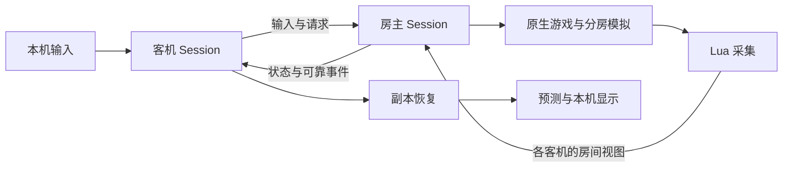

# 架构概览

Isaac LAN 在游戏进程中加载原生 DLL，并嵌入 Lua 桥接。房主运行原版玩法与分房模拟，客机提交输入、应用权威状态，并显示自己的房间。游戏对象、Lua 调用、状态采集／应用和会话决策留在游戏主线程；一个网络线程负责事件驱动的收发和实时字节处理，按需启动的大数据工作线程负责存档压缩、校验和解压。线程之间转移独立数据的所有权，不共享游戏对象。

## 技术选择

| 选择 | 收益 | 代价或约束 |
| --- | --- | --- |
| 房主权威状态同步 | 无需各进程保持完整 RNG 和执行顺序一致 | 需要采集、编码和应用状态；伤害、拾取等等待房主结果 |
| 原生后端＋Lua 桥接 | 复用原版房间、战斗、存档与多人 HUD | 原生调用、布局和对象生命周期必须逐版本核对 |
| IPv4／IPv6 UDP／ENet | 实时视图允许过期，控制事务与检查点可靠交付 | 分片缺失会丢弃整份实时视图；可靠恢复共享带宽，仍需限制积压 |
| 本机移动预测 | 移动无需等待每次网络确认 | 仅用于显示，复杂外力和特殊移动可能纠偏 |

加载链为 `winmm.dll → isaac_lan_probe.dll → 嵌入 Lua`。分房通过顺序切换原生房间上下文实现；每份客机视图包含全队角色主要状态、共同地图，以及本机房间的实体、网格和表现。

## 支持边界

- 原生后端针对 Windows x86 Repentance+ `v1.9.7.17.J460`；新版本需要重新校验入口、ABI 与布局。
- 所有玩家须使用相同协议和扩展构建；Mod 差异只提示，不通用同步 Mod 私有数据。
- 房主不能迁移。整场续玩要求原人数、原加入顺序；运行中的客机重连按保留的玩家标识恢复。

按修改任务阅读[分层与所有权](https://github.com/BMingSY/isaac-lan/blob/main/docs/layers-and-compatibility.md)、[同步契约](https://github.com/BMingSY/isaac-lan/blob/main/docs/synchronization.md)、[会话恢复](https://github.com/BMingSY/isaac-lan/blob/main/docs/session-lifecycle.md)或[房间与表现](https://github.com/BMingSY/isaac-lan/blob/main/docs/rooms-and-presentation.md)。构建和检查入口见[开发与测试](https://github.com/BMingSY/isaac-lan/blob/main/docs/development-and-testing.md)。
