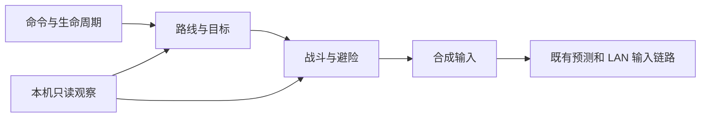

# LANBOT 实现与约束

LANBOT 读取已有视图并合成正常移动和射击输入，主机继续决定伤害、拾取、传送和道具效果。命令与支持范围见[使用说明](https://github.com/BMingSY/isaac-lan/blob/main/docs/lanbot.md)。

## 模块与数据流

| 模块 | 职责 |
| --- | --- |
| [lanbot.lua](https://github.com/BMingSY/isaac-lan/blob/main/src/bridge/lanbot.lua) | 命令、状态、调度、蓄力与输入清理 |
| [observe.lua](https://github.com/BMingSY/isaac-lan/blob/main/src/bridge/lanbot/observe.lua) | 本机角色、房间、敌人、地形和武器观察 |
| [planner.lua](https://github.com/BMingSY/isaac-lan/blob/main/src/bridge/lanbot/planner.lua)、[navigation.lua](https://github.com/BMingSY/isaac-lan/blob/main/src/bridge/lanbot/navigation.lua) | 连通图、目标、预算与有界 A* |
| [terrain.lua](https://github.com/BMingSY/isaac-lan/blob/main/src/bridge/lanbot/terrain.lua)、[hazards.lua](https://github.com/BMingSY/isaac-lan/blob/main/src/bridge/lanbot/hazards.lua) | 地形、周期机关和连续碰撞预测 |
| [combat.lua](https://github.com/BMingSY/isaac-lan/blob/main/src/bridge/lanbot/combat.lua) | 站位、短时轨迹评分、射击与受阻恢复 |
| [greed.lua](https://github.com/BMingSY/isaac-lan/blob/main/src/bridge/lanbot/greed.lua)、[items.lua](https://github.com/BMingSY/isaac-lan/blob/main/src/bridge/lanbot/items.lua) | 贪婪阶段、购物预算与道具分配 |
| [automation_input.h](https://github.com/BMingSY/isaac-lan/blob/main/src/core/automation_input.h) 与版本输入后端 | 输入来源、边沿、过期释放和预测共用 |

组件通过嵌入清单装配，使用既有输入协议，不依赖测试夹具或实验目录。

## 状态与观察

托管状态为 `off`／`running`／`paused`，目标模式与战斗风格独立。切换模式取消旧任务，退出、断线或整局身份变化重置状态。观察与缓存绑定整局、楼层、房间、维度和角色身份，换房或身体替换后重新建立。

客机以已接受快照中的权威坐标判断出口接触，避免显示预测被误认为真实到达。观察超过 250 ms、对象失效或决策异常时释放输入并等待或暂停，不使用失效原生指针。

## 规划与决策

| 阶段 | 策略与边界 |
| --- | --- |
| 探索 | 连通图来自访问记录、可见地图与门；大型房间入口归并，不读取未知房间内容 |
| 路线 | `run` 完成可达分支再选出口，`explore` 完成后等待，`hold` 不离房；失败边冷却不等于探索完成 |
| 目标 | 房间／楼层变化确认到达；门口通道优先离门，资源、连接或对象变化使计划失效 |
| 可通行性 | 按角色半径、飞行、坑洞、网格和实体障碍检查完整轨迹；周期机关须有足够通过窗口 |
| 战斗 | 先排除不可通行轨迹，再按受伤风险、退路、射程、视线和目标进度评分；保留短期方向稳定性 |
| 避险 | 使用连续相对轨迹与惯性、观察年龄、输入延迟、减速尾段预测，覆盖已识别的敌人、弹幕、激光和爆炸 |
| 受阻恢复 | 重规划、切换输出位置或冷却目标；全部候选无效时报告等待，不直接改坐标或碰撞 |
| 贪婪 | 每层按 `fight → supply → loot → gather → leave` 推进，补给预算与完成状态保留到换层 |
| 道具分配 | 按收益、预算和已有数量选择可接收队友；稳定身份用于平分，目标消失、过期或世界重建清理预留 |

出口、商品和危险机关分别有接近权限；未选中的目标不会因路径经过而自动允许触碰。武器和危险模型是近似值，未知组合不保证最优走位。

## 输入与执行预算

每个渲染帧最多决策一次，仅替换移动／射击动作，UI 与人工道具操作保留。网络采集和本机预测复用同一份合成输入，持有值与按下边沿分别管理。暂停、关闭或世界失效时释放输入；超过三帧未更新的输出归零，已经发出的输入不能撤回。

观察扫描、寻路展开、候选轨迹和预测长度均有上限。规划按事件或低频更新，实时避险不等待外部服务。测试方法与按需验收范围见[开发与测试](https://github.com/BMingSY/isaac-lan/blob/main/docs/development-and-testing.md)。
