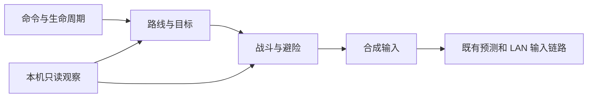

# LANBOT 实现与约束

命令和支持范围见[使用说明](lanbot.md)。LANBOT 只读取已有视图并合成正常输入；主机继续决定伤害、拾取、传送和道具效果，不直接修改坐标、碰撞或原生状态。

## 模块与数据流

| 模块 | 职责 |
| --- | --- |
| `bridge/lanbot.lua` | 命令、模式／风格、状态、决策调度、蓄力与输入清理 |
| `lanbot/observe.lua` | 本机角色、房间、敌人、地形和武器观察 |
| `lanbot/planner.lua`、`navigation.lua` | 已观察连通图、目标、预算与有界 A* |
| `lanbot/terrain.lua`、`hazards.lua` | 地形／按钮适配、尖刺周期与连续碰撞预测 |
| `lanbot/combat.lua` | 输出站位、短时轨迹评分、射击与受阻恢复 |
| `lanbot/greed.lua`、`items.lua` | 贪婪楼层阶段、购物预算和道具分配 |
| `engine/versions/j460/input.cpp`、`core/automation_input.h` | 本机输入来源、边沿、过期释放与预测共用 |
| `bridge/app/main.lua`、`runtime/session.cpp` | 控制台、渲染决策与会话边界接入 |

组件由 [`modules.txt`](../src/bridge/modules.txt) 嵌入，不新增网络消息或第三方公开 API。生产输入不依赖实验目录标记或 `test_gamepad`。

## 状态与输入

- 托管状态为 `off`／`running`／`paused`，目标模式与战斗风格独立。切换模式会取消旧任务；退出、断线或 run ID 变化重置整套状态。
- 每个渲染帧最多决策一次。仅替换动作 0–7（移动／射击），不与相反的人工方向叠加；UI 和人工道具输入继续保留。网络采集与客机预测复用同一份合成输入。
- 持有值和按下边沿分开处理。暂停、关闭、世界失效时释放旧值与未消费边沿；超过三帧未更新的输出归零，不能撤回已发到对端的输入。
- 缓存绑定整局、楼层、房间、维度及角色身份。换房、角色替换和复活后重新观察；不能把 `Isaac.GetPlayer(0)` 或旧裸指针当成本机身份。
- 客机通过注入的 `sync/actor_pose` 读取已接受快照的坐标和速度，以权威坐标判断出口接触；观察超过 250 ms 或对象失效时停止输入。决策错误释放输入并暂停。

## 探索与目标

连通图来自实际访问的房间、可见地图和门，不读取未知房间内容。节点使用规范的 `(dimension, roomIndex)`，大型房间的多个入口归并。`run` 完成可达分支后才选普通出口，`explore` 完成后等待，`hold` 不离房；失败边按来源房间冷却，不能把冷却当作探索完成。

门和出口都是显式目标，以实际房间／楼层变化确认到达。进入门口通道先取消战斗绕行，进房后保留离门任务，向内移动至少 70 个坐标单位再选路。资源、目标消失或门连接变化使旧计划失效。

| 边界 | 处理 |
| --- | --- |
| 出口误触 | 出口触碰范围独立于网格，只有当前选中的出口获准接近；已重叠时允许向外恢复 |
| 闭合 Boss 出口 | 保留 50 像素加角色半径的保护区，走到安全点等待原版开启 |
| 大宝箱 | 同房存活角色先离开接触区，至少观察 15 个权威 tick 再重新接触；坐标缺失继续等待，不写计时器或直接触发结局 |
| 宝箱与虚空入口重叠 | 普通路线优先宝箱，从横向边缘接近并保留未选出口保护 |
| 普通压力按钮 | 没有战斗目标时也可处理，以原版 `State=3` 确认激活 |
| 交替尖刺 | 观察完整收起周期，按最短区间扣除裕量；窗口不足等待，不算静态寻路失败。漏采样、身份变化或 tick 回退清空周期；清房后永久收起可通过 |
| 拾取与障碍 | 按需求选择免费资源；已有主动不交换。大便和普通／红火用正常射击清除，破坏前仍阻挡；机器另记实体碰撞区域 |

## 战斗与避险

局部路径先检查角色半径、飞行、坑洞和网格，再评估八方向及静止的短时轨迹。预测包含惯性、观察年龄、输入延迟及到点后的减速尾段；危险使用连续相对轨迹最短距离，覆盖已识别的接触敌人、弹幕、激光、爆炸和地面效果。

先排除不可通行轨迹，再按预计受伤、退路、射程、视线和目标进度评分，保留短期方向与目标稳定性。近身敌群计入停顿后的追击压力；受阻后重规划或冷却目标，全部路线失效时报告等待原因。

`orbit`／`seek` 分开管理绕行与寻找输出位置：连续 90 个决策帧没有射击机会时转为 `seek`，恢复射击后再绕行。只统计附近的接触危险；已清房且有出口时，残留 Boss 雕像不再成为攻击目标，但仍保留实际接触伤害。

客机复制实体的玩法碰撞可能关闭，不能只靠 `IsVulnerableEnemy()` 选目标。`FLAG_NO_TARGET` 实体取消攻击资格但保留危险。普通泪弹轴向瞄准，已识别追踪泪弹允许有限偏轴；都检查射程与视线。贴墙目标取先接触的一侧，不要求射线穿过墙。蓄力武器的松开至少跨三次渲染采样，避免被 30 Hz 网络采集跳过。

原版炸弹无可读 `ExplosionCountdown` 属性，观察按已可爆炸处理并结合 `RadiusMultiplier` 避让，不写倒计时。速度、蓄力和危险预测是近似模型，未识别的武器组合／Boss 预兆需实机确认。

## 贪婪阶段与道具

每层持久推进 `fight → supply → loot → gather → leave`，原版换层后重置。先等队友启动按钮，战斗避开停止按钮，Boss 波后补给和收集道具房，再集合离场；跳过可选恶魔奖励波。补给／收集完成或持续不可达后向前推进，避免需求重新竞争导致无限进出商店。

道具估值使用品质、伤害／射速、生命收益和重复持有情况，先预留钥匙与恢复预算。按 `预计收益 / (5 + 已有道具数)` 分配给存活、连接、同维度且可拾取的队友，付费物还检查接收者预算；平分时按稳定身份排序。其他 BOT 避开预留道具，预留 600 个权威 tick 后可重新争取；目标消失、换房或重建清理记录。

清房后允许经过完整碰撞足迹检查的斜向连线，沿墙保持合法的单轴移动；已穿入避让区时只允许向外恢复。若所有持续方向都劣于静止但目标未到达，额外评估“输入两次更新、松键滑行十二次更新”的八个候选，总数最多 17。完整滑行仍检查危险、商品和出口，每帧重算；战斗不增加这组候选。

## 性能与验证

限制观察扫描、寻路展开、候选数和预测长度。规划按事件或低频更新，实时决策目标为单次 2 ms；该目标尚未普遍达到，不能以通关结果替代耗时和走位评估。当前无需外部 Agent；未来若接入，高层结果应异步返回并校验会话／任务代次，不能阻塞本地躲弹或网络轮询。

离线测试覆盖命令、归属、生命周期、输入合成、持续过门、危险和受阻恢复；原生控制台、不同角色／武器、多人、延迟、连续画面与正常操作按[测试流程](development-and-testing.md)集中验收。通关夹具的保护、固定配装和加速条件必须随结果记录，历史结果见[LANBOT 验收索引](history/README.md#lanbot)。
