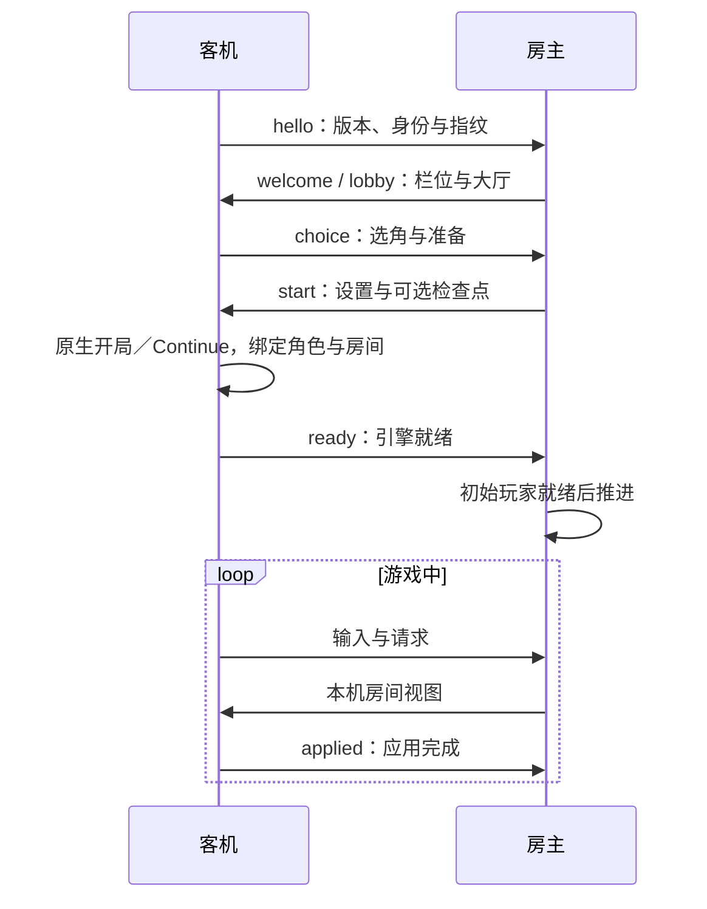
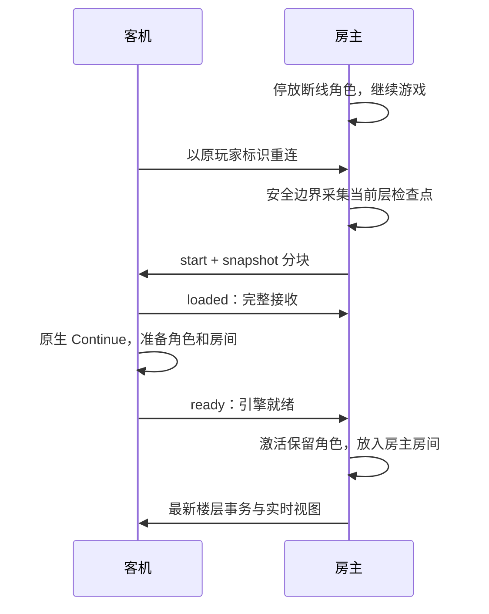

# 会话与状态恢复

运行协调器管理启动、楼层事务、保存与退出；网络负责有序交付，游戏后端负责原生加载和对象所有权。网络已连接、桥接已准备和原生世界可应用是不同边界。

## 大厅与开局

客机握手携带协议版本、扩展指纹、玩家标识和 Mod 指纹。协议与扩展必须匹配，Mod 差异只提示。房主发布种子、难度、角色顺序和运行规则；每名玩家的角色资格来自自己的存档。规则变化会清空准备状态，旧规则代次的准备请求无效。

[`bridge/runtime/session.lua`](https://github.com/BMingSY/isaac-lan/blob/main/src/bridge/runtime/session.lua) 管理 `idle → starting → initializing → preparing → ready`。原生虚拟控制器就绪后，同一准备代次只请求一次启动。[角色绑定组件](https://github.com/BMingSY/isaac-lan/blob/main/src/bridge/runtime/party.lua) 校验每个槽位的独立角色及控制器归属；角色创建、启用房间、建立同步门和恢复房间均在 `preparing` 内执行，嵌套回调不能重复创建角色。Continue 在首次原生输入更新前先经过一次受保护的角色绑定，按存档顺序恢复槽位，不用物理控制器 ID 推断归属。关闭使代次失效，过期回调不能继续推进。准备错误通知运行协调器结束当前游戏，不逐帧重试半完成操作，前端仍可处理重连和离开。

网络 `loading` 只表示检查点尚未传完，传完仍需原生加载与引擎就绪。初始开局等待所有初始玩家，每个加载请求最多等待 60 秒；运行中的重连加载不阻塞已在线玩家。

## 原生换层与重建

房主发起原生换层时发布可靠 `Stage` 事务，携带来源楼层、类型、动画、种子、路线标记、来源房间和新 `floorEpoch`。各端按同一来源上下文执行原生选路，房主的选择不由客机当前视口推导。

事务按以下顺序执行：

1. 接受新代次，拒绝重复或过期事务。
2. 清理旧视图、增量基线、预测与实体映射。
3. 执行原生过场、换层或重建。
4. 楼层准备完成后重新接入房间上下文，应用新代次视图。

普通在线换层不通过完整 Continue 重建。当前层重置与 R 键重开同步原生种子及布局；跑圈由房主确认后执行原生流程。特殊路线由兼容组件提供策略，不在网络层识别路线。原生来源上下文与转场能力见[后端参考](https://github.com/BMingSY/isaac-lan/blob/main/docs/native-backend.md#转场与暂停)。

## 暂停与退出

任何在线玩家可发起全队暂停，由发起者恢复；发起者离队后由房主恢复。视图同步暂停状态和发起者，菜单页、光标、Items 与 Options 由各端本机输入操作。

恢复和房主保存退出转换为可靠会话命令。客机菜单离开主动关闭连接，由房主按离线生命周期停放角色。暂停菜单不向房主提交方向或确认动作；暂停期间保留射击持有值。Options 关闭前保存本机配置，Switch Controller 不允许改写联机控制器绑定。

只有房主可以保存并结束会话。客机单独离开时停放其角色，保留主要状态；离线角色不参与战斗和奖励人数计算。退出、换层和迁移均在安全更新边界执行，单人存档及进度保护持续到原生退出完成。

## 当前层重连

运行中的原角色由 `player-id.txt` 标识。检查点在所有已加载房间保存后采集，临时将停放角色纳入序列化名单，不让其参与战斗。客机准备完成前不提交有效玩法输入，也不计入在线人数。

加载期间房主继续推进，连接保留最新楼层事务；客机就绪后先处理事务，再接收实时视图。等待与加载界面使用房主提供的本局角色名单。

客机菜单提供“重连游戏”和“离开游戏”。主动重连先释放旧连接，在原生退出结束后使用原地址、端口及玩家标识重新连接；意外掉线自动尝试一次。恢复状态跨原生退出保留，首个实时视图成功应用后结束，菜单收起并释放输入。连接或恢复失败时保留重试入口，不自动循环重建失败的角色状态。离开取消待执行的重连并清理会话。

检查点使用原版保存／续玩语义，道具和血量等主要状态恢复，临时实体和部分计时可能重建。系统不支持中途增加新玩家或迁移房主。

## 联机存档与续玩

[`session_archive.h`](https://github.com/BMingSY/isaac-lan/blob/main/src/runtime/session_archive.h) 定义存档封装：扩展指纹、开局设置、运行规则、全队位置、原生 GameState 和完整性哈希。读取须匹配格式与指纹，完整文件上限 8 MiB。

房主三个存档栏分别使用 `session-1.bin`、`session-2.bin`、`session-3.bin`，与单人 Continue 分开管理。写入采用临时文件替换；失败时保留旧文件和进程内待保存快照，重试固定使用原存档栏，成功前不能开始新联机局。

整场关闭后的续玩要求原房主、原存档栏、原人数和原加入顺序。运行中重连按玩家标识恢复，与整场续玩的栏位条件分别校验。临时挑战不覆盖已有联机存档，只支持运行中重连，详见[联机挑战](https://github.com/BMingSY/isaac-lan/blob/main/docs/lan-challenges.md)。

## 全队回退

发光沙漏为每个控制器保存上一次进房时的全队原生状态与位置。房主在使用者源房间执行原版路线判定，通过可靠事务发送结果；客机回放该结果，不自行重新选路。

原生选择回退时恢复检查点与全队位置；选择 Home 或其他房间转场时保留对应原生行为，不强行恢复旧位置。无检查点时只允许符合原版条件的转场。回退可以跨层，状态序号继续递增，世界代次推进，回退前的视图不得再次应用。

## 失败边界

| 失败位置 | 处理 |
| --- | --- |
| 单个客机协议错误或连接超时 | 房主移除该连接并继续运行 |
| 客机状态应用或桥接错误 | 客机结束当前游戏、返回大厅；原会话和身份有效时可重连 |
| 房主桥接或原生适配错误 | 会话级失败，可能结束整场游戏 |
| 联机存档写入失败 | 保留旧文件与待保存快照，等待重试 |

完整性哈希用于传输和存档校验，不比较双方随机序列。原生状态应用不具备事务回滚，失败不能通过提交完成回执掩盖。
