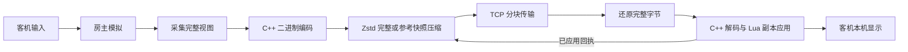

# 网络与状态同步

房主运行权威玩法，客机提交输入并恢复房主发布的状态。网络层只处理消息和字节，不识别道具、Boss 或游戏对象；状态采集与应用由桥接同步层负责。

## 数据流与职责

| 数据 | 方向 | 交付语义 |
| --- | --- | --- |
| 输入与请求 | 客机 → 房主 | 持有值取最新值，按下边沿保留到消费；请求由房主验证身份与权限 |
| 实时视图 `WorldState` | 房主 → 对应客机 | 每份可还原为完整状态；尚未开始发送的旧视图可被最新视图替换 |
| 可靠事务 | 双向，以房主发布为主 | 大厅、开局、重开、检查点、换层、回退、结束和返回大厅按序交付，不参与视图合并 |
| 聊天通信 `communication` | 客机请求 → 房主；房主 → 接收者 | 独立限额的可靠字节消息，不随世界快照合并；内容契约见[聊天与控制台](https://github.com/BMingSY/isaac-lan/blob/main/docs/chat-console.md) |

生命周期消息 `lifecycle` 使用独立限额的可靠通道，发送者由连接确定；运行层校验投票所属的运行标识、代次和在线名单。全员同意后的 `restart` 消息携带新运行标识、世界代次和开局设置，`ready` 同时校验运行标识与首 tick。投票及退出／重建顺序见[全队重新开局](https://github.com/BMingSY/isaac-lan/blob/main/docs/session-lifecycle.md#全队重新开局)。

通关后的 `returnLobby` 回执携带当前运行标识。已退出的一端进入 `returning`，继续轮询连接而不启动游戏；房主收齐当前在线成员的回执后清理本局数据、提升大厅规则代次并发布 `lobby`。旧局回执与旧规则下的准备请求不能解除新大厅的屏障，结局播放速度不要求一致。

第三方动作使用有独立限额的可靠消息，具体契约见 [Mod API](https://github.com/BMingSY/isaac-lan/blob/main/docs/third-party-mod-integration.md)。房主内部的 `Frame` 仅汇总输入，不用于让客机重放同一套玩法模拟。

## 输入与时间

客机按本机渲染帧采样输入，同一帧的重复轮询只采一次。`input_hz` 支持 30／60，默认 60；每份输入包含 16 个量化动作值及按下边沿。卡顿后只发送当前采样，不补发积压的历史样本。

房主在原生模拟步骤前消费输入，完整更新正常为 30 Hz；运行中不等待每名客机逐帧提交。持有值可以复用，边沿消费后清除；超过 500 ms 没有新输入时使用中性输入。首次加载屏障见[会话生命周期](https://github.com/BMingSY/isaac-lan/blob/main/docs/session-lifecycle.md#大厅与开局)。

| 标识 | 用途 |
| --- | --- |
| `tick` | 权威状态的模拟序号，用于排序与应用回执 |
| `inputSequences` | 房主已消费的各玩家输入序号，用于预测确认 |
| `floorEpoch` | 换层、重建和回退的代次，用于隔离不同世界状态 |
| 房间键 | `(dimension, roomIndex)`，与楼层代次共同限制输入的适用范围 |

回执确认的是状态应用完成，不比较双方的 RNG。菜单和本机界面消费本机物理输入；暂停、退出等会话操作走可靠命令。移动预测的显示边界见[房间与表现](https://github.com/BMingSY/isaac-lan/blob/main/docs/rooms-and-presentation.md#移动预测与镜头)。

## 完整视图与实体身份

每份视图包含全队主要角色状态、共同楼层与地图，以及接收者当前房间的实体、网格和表现。同房角色携带完整外观，异房角色保留多人 HUD 所需状态。任意 Mod 私有表、Lua 源码和原生指针不进入视图。

采集以 `(floorEpoch, tick)` 为不可变代次，在该代次内复用公共字段、角色和同房数据；缓存不跨 tick。音效和演出按接收者筛选。字段由 [world_schema.lua](https://github.com/BMingSY/isaac-lan/blob/main/src/bridge/sync/world_schema.lua)、[fields.lua](https://github.com/BMingSY/isaac-lan/blob/main/src/bridge/sync/fields.lua) 和 [entity_schema.lua](https://github.com/BMingSY/isaac-lan/blob/main/src/bridge/sync/entity_schema.lua) 定义。泪弹、跟班、效果与精灵的常用属性通过[具名批量能力](https://github.com/BMingSY/isaac-lan/blob/main/docs/native-backend.md#实体字段批量读写)读写，Lua 模板决定字段顺序，版本后端保留原属性语义；其他类型使用游戏 Lua API。

实体 ID 由房主分配，客机维护 `ID → EntityPtr`。同一活动对象复用其 `EntityPtr` 与显示轨迹记录，原生引用失效或角色对象替换时重新建立引用；换房清理显示轨迹，退出清理全部引用。恢复时先回收过期实体，再创建／更新实体，最后绑定父、子、生成者和目标引用。身份与本机地址、实体池槽位无关；原生对象仍由游戏分配和释放。特殊实体引用通过兼容组件和具名后端能力接入，见[原生能力参考](https://github.com/BMingSY/isaac-lan/blob/main/docs/native-backend.md#实体引用与房间数据)。

客机应用完整视图时遵循[恢复顺序](https://github.com/BMingSY/isaac-lan/blob/main/docs/layers-and-compatibility.md#采集与副本恢复)，全部成功后才提交 tick。原生楼层未准备好时保留最新视图，延后应用。普通状态允许在原生半帧边界应用；首次视图、暂停／名单变化、换层、换房及角色替换在完整更新边界处理。`betweenUpdates` 预检不写入房间或角色，返回 `false` 表示继续等待。

客机保留显示和资源清理所需的原生更新，拦截同步实体的玩法更新与碰撞。伤害、拾取、房门决策和道具效果由房主执行；副本恢复不重放使用动作。

## 传输、压缩与积压

连接使用非阻塞 IPv4 TCP，由主线程轮询。域名在独立线程解析；取消或重连使旧解析结果失效。消息采用两字节长度前缀，正文整数使用大端编码，大载荷按块传输。

[Zstd 适配器](https://github.com/BMingSY/isaac-lan/blob/main/src/core/zstd.cpp)使用快速级别 `-1`，分别生成独立帧和引用不可变已确认快照的 prefix 帧，选择较小载荷；无压缩收益时发送原始字节。prefix 直接使用完整快照，不需要训练字典或另外构造字节补丁。压缩上下文由会话持有并复用，每次调用结束清除借用的 prefix；不同客机之间不共享基线。首块标明完整／参考模式、基线 tick 与楼层代次。

协议版本为 31。压缩封套为一字节模式和四字节大端原始长度：`0` 为原始字节，`3` 为独立 Zstd 帧，`4` 为 prefix 帧；`1`／`2` 仅保留旧 XPRESS／DEFLATE 读取。Zstd 帧必须含已知原始长度和内容校验和，不接受训练字典 ID、串接帧或尾随字节；解码前验证输出大小和窗口均不超过 2 MiB。Zstd 静态链接，不依赖系统安装或额外 DLL。

该增量位于完整状态编码之后，客机也要还原完整字节再解码。它减少传输量，不免除整份状态的采集、编码与解码成本。网络层不按游戏字段解释或修改状态。

每个客机独立持有正在发送的视图、待发送的最新视图和已确认基线。已经开始发送的视图完成分块后才发送下一份；未开始的视图可替换。每份增量直接引用该客机已确认应用的基线，不依赖被替换的中间视图。

客机输入只合并发送队列末尾尚未发送任何字节的输入消息，保留最新方向、序号与同房间尚未消费的按键边沿；跨房／跨层只保留原有会话按键规则。合并不越过中间的可靠消息，不改写已部分发送的消息，也不撤回进入 TCP 的字节。接收端继续按最新输入及累积边沿消费，不回放旧移动轨迹。

| 限制 | 当前值 |
| --- | --- |
| 玩家数 | 最多 4 人 |
| 单消息正文／每段大块载荷 | 4096／3000 字节 |
| 完整实时视图／检查点与存档 | 2／8 MiB |
| 未确认视图窗口 | 每客机 4–16 份，按最低已测 RTT 调整 |
| 开始新视图的未确认载荷阈值 | 64 KiB，可再容纳一份正在发送的视图 |
| 完整视图历史缓存 | 每连接 16 MiB；客机另限 32 份 |

达到窗口或容量上限时，仅更新待发视图，不等待该客机追上后才推进其他玩家。已入 TCP 队列的字节仍按序交付。换层／回退事务使旧视图、组装状态和基线失效；新连接从完整视图建立基线，旧代次回执不能建立新基线。

## 状态编解码

Lua 决定游戏字段契约、采集与恢复顺序，通过游戏 API 或具名批量能力访问属性。[`state_encode(value, memo)`／`state_decode(bytes)`](https://github.com/BMingSY/isaac-lan/blob/main/src/engine/state_codec.cpp) 在主线程通过共用 Lua 5.3 ABI 批量处理数组，字节读写与大小限制位于可移植的 [state_codec.h](https://github.com/BMingSY/isaac-lan/blob/main/src/core/state_codec.h)。编解码接口不访问游戏对象、原生布局或网络连接。Lua [参考实现](https://github.com/BMingSY/isaac-lan/blob/main/src/bridge/sync/codec.lua) 用于离线对照与未绑定原生能力的夹具。

值仅包含布尔、整数、有限 float32、字符串和普通数组。类型标记、整数宽度和大端格式由原生与 Lua 参考实现的逐字节对照检查；整数与浮点数的类型、负零及有符号 64 位值保持原样。编码使用连续缓冲区，Lua 分配失败时由 userdata 的终结器释放 C++ 缓冲区；正常返回或 C++ 校验失败立即释放。

`memo` 由采集组件持有，只标记当前采集代次内不可变的数组。缓存记录完整字节、节点数与相对深度，重复引用仍计入整份视图的预算；普通数组不自动缓存，不可在标记后修改内容或缓存元数据。

客机仅在预检尚未进入原生恢复时保留最新解码结果，用于半帧延后到完整更新的同一份状态。字节或 tick 变化、楼层等待、视图重置及开始恢复都会使该缓存失效。库存比较直接检查角色类型、道具种类／数量和饰品槽，仍保留每 30 tick 的原生库存纠偏。

泪弹、跟班和效果实体的 `nativeFields`（实体字段 26）携带数值块，顺序为通用属性数组、类型属性数组、精灵偏移、精灵缩放和颜色；原位置 8、9、15、16、17 为 `false`。数值块沿用相同的标记和大端编码，由具名字段计划在原生端直接采集和恢复，避免逐帧构造、遍历中间 Lua 表。其他实体及离线 Lua 参考路径仍使用展开的属性数组，字段 26 为 `false`。字段名称与顺序由 [entity_schema.lua](https://github.com/BMingSY/isaac-lan/blob/main/src/bridge/sync/entity_schema.lua)、[entity_codec.lua](https://github.com/BMingSY/isaac-lan/blob/main/src/bridge/sync/entity_codec.lua) 和 [fields.lua](https://github.com/BMingSY/isaac-lan/blob/main/src/bridge/sync/fields.lua) 定义，原生白名单不决定玩法或引用关系。

## 校验与失败边界

| 边界 | 检查与结果 |
| --- | --- |
| 握手 | 协议版本与扩展指纹必须一致；Mod 指纹差异只提示 |
| 消息与分块 | 校验字段范围、序号、偏移和完整性，拒绝错误拼接与过期状态 |
| 状态编码 | 只接受布尔、整数、有限 float32、字符串和数组；少于 250000 个节点，深度小于 12；字符串和数组长度最多 65535 |
| 副本应用 | 校验楼层准备、角色控制器与实体字段；失败不提交完成 tick，已执行的原生写入不会自动回滚 |

协议与字段版本分别由 [protocol.h](https://github.com/BMingSY/isaac-lan/blob/main/src/net/protocol.h) 和 [world_schema.lua](https://github.com/BMingSY/isaac-lan/blob/main/src/bridge/sync/world_schema.lua) 管理。变更字段时同步更新生产者、消费者、版本／指纹和相关契约。

世界字段版本为 25，精灵原生载荷使用格式 2，包含动画挂点帧和事件状态。角色和服装在渲染边界仍恢复权威姿态；同名动画通过完整状态恢复，避免每帧重新初始化动画。不同字段版本不能互相应用，嵌入模块与 DLL 指纹继续参与连接校验。

客机协议或应用错误会结束其当前游戏并返回大厅；房主自身的桥接错误可能结束整场会话，详见[失败边界](https://github.com/BMingSY/isaac-lan/blob/main/docs/session-lifecycle.md#失败边界)。Ping 是包含轮询与排队的往返时间，不能代替状态处理耗时；测量与排查方法见[诊断参考](https://github.com/BMingSY/isaac-lan/blob/main/docs/diagnostics-and-resource-testing.md)。
